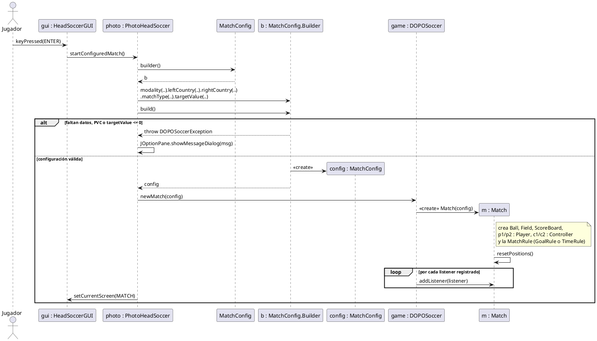
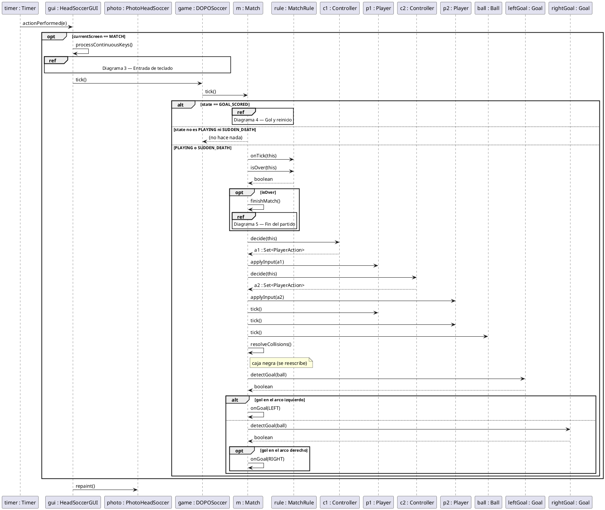
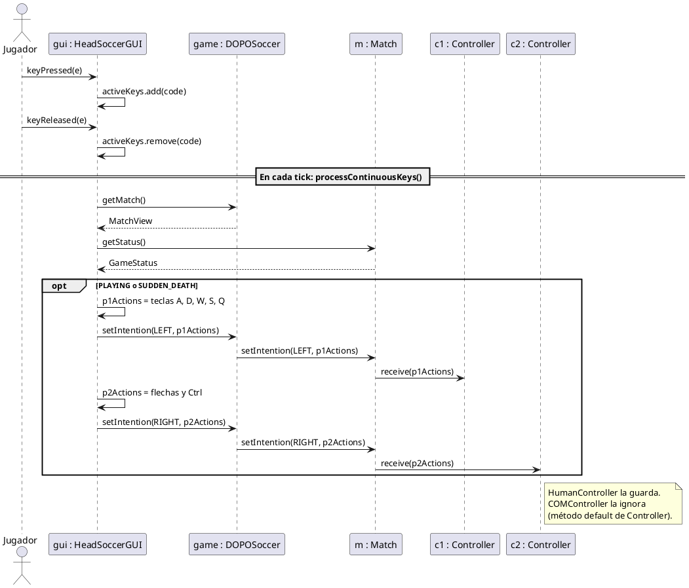
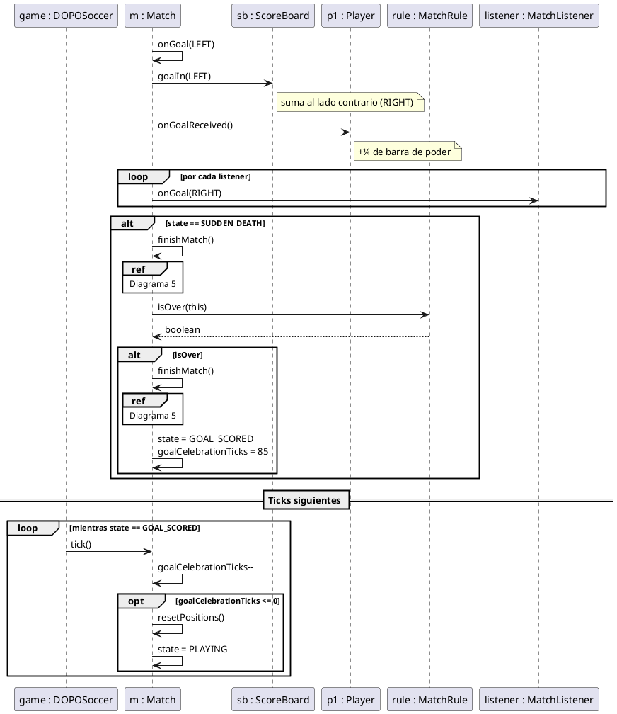
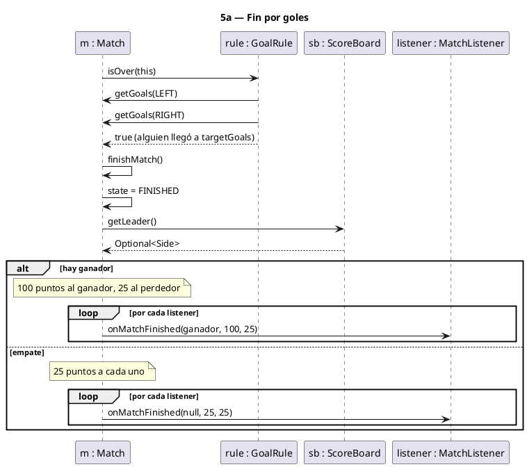
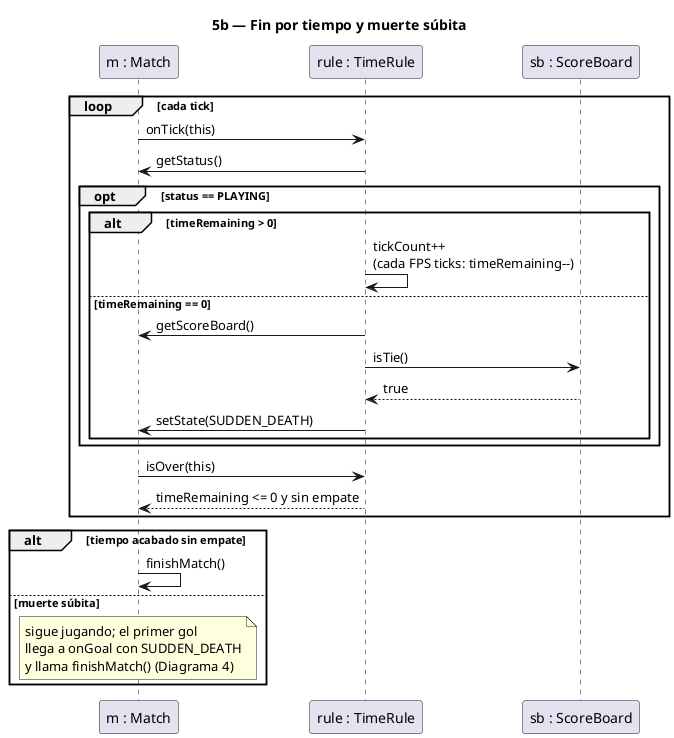
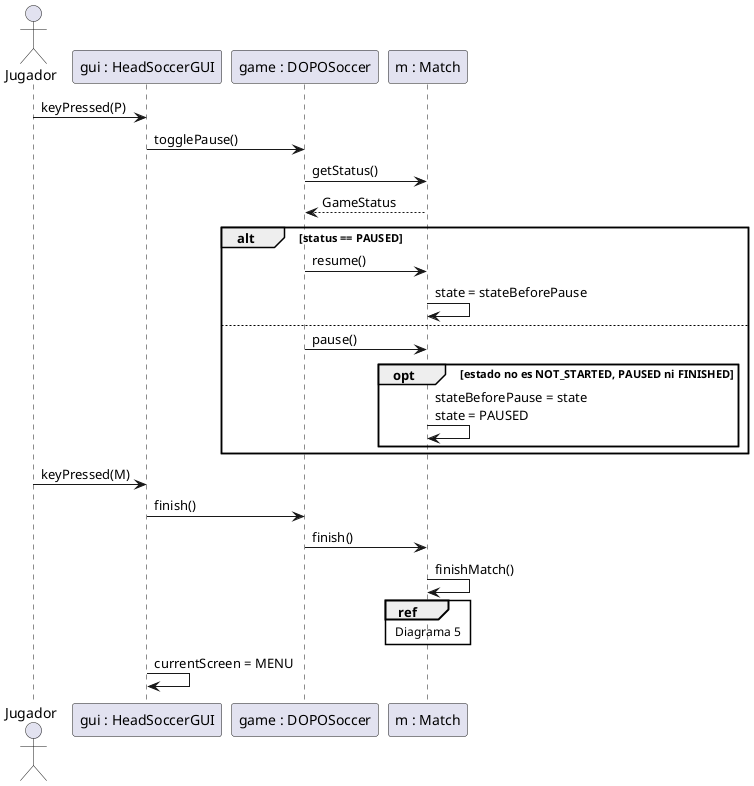

# Para qué es esta guía

Esta guía describe **6 diagramas de secuencia** que se pueden hacer **ya**, porque las clases y los métodos que aparecen en ellos están terminados (commit `fix2`) y no van a cambiar, o van a cambiar tan poco que corregir el diagrama será cosa de un minuto.

Al mismo tiempo, Juan va a reescribir **la física y el interior de `Player`** (patada, travesaño, `PlayerBody`, vida y efectos). Todo eso queda **fuera** de estos diagramas a propósito. La sección final, "Qué NO hacer", lo explica.

Cada diagrama trae:

1. **Objetivo**: qué caso de uso cuenta.
2. **Participantes**: las líneas de vida, en orden de izquierda a derecha.
3. **Precondición**: en qué estado empieza.
4. **Mensajes**: numerados, con el nombre exacto del método en el código.
5. **Fragmentos** (`alt`, `opt`, `loop`, `ref`) con su condición.
6. **Cuidado**: lo que se debe dibujar como una sola flecha, sin abrirlo.
7. **Código PlantUML** opcional, para verificar el dibujo (se puede pegar en <https://www.plantuml.com/plantuml> y comparar con lo que hiciste en Astah).

---

# Convenciones para todos los diagramas

**Nombres de las líneas de vida.** Úsalos **iguales en los 6 diagramas**:

| Línea de vida | Clase | Paquete |
|---|---|---|
| `Jugador` (actor) | la persona frente al teclado | — |
| `timer : Timer` | `javax.swing.Timer` | Swing |
| `gui : HeadSoccerGUI` | ventana principal, `KeyListener` | `presentation` |
| `photo : PhotoHeadSoccer` | panel que dibuja y escucha eventos (`MatchListener`) | `presentation` |
| `b : MatchConfig.Builder` | constructor de la configuración | `domain` |
| `config : MatchConfig` | configuración ya validada | `domain` |
| `game : DOPOSoccer` | **fachada** del dominio | `domain` |
| `m : Match` | el partido | `domain` |
| `rule : MatchRule` | regla de fin (`TimeRule` o `GoalRule`) | `domain` |
| `c1 : Controller`, `c2 : Controller` | quién decide por cada jugador | `domain` |
| `p1 : Player`, `p2 : Player` | jugador izquierdo y derecho | `domain` |
| `ball : Ball` | el balón | `domain` |
| `sb : ScoreBoard` | el marcador | `domain` |
| `leftGoal : Goal`, `rightGoal : Goal` | los arcos | `domain` |
| `listener : MatchListener` | cualquier observador (hoy, `photo`) | — |

**Notación UML que se pide:**

- **Mensaje síncrono:** flecha continua con punta rellena (`metodo(parámetros)`).
- **Retorno:** flecha punteada, solo cuando el valor importa (`: boolean`, `: Set<PlayerAction>`, `config`).
- **Creación:** flecha punteada `«create»` que llega a la **caja** del objeto nuevo; la línea de vida empieza a esa altura.
- **Mensaje a sí mismo:** flecha que sale y vuelve a la misma línea de vida (`resetPositions()`, `finishMatch()`).
- **Fragmentos combinados:**
  - `alt [condición] / [else]` cuando hay caminos excluyentes;
  - `opt [condición]` cuando algo pasa o no pasa;
  - `loop [condición]` para repeticiones (por cada listener, cada tick);
  - `ref NombreDiagrama` para decir "aquí va lo del otro diagrama" sin repetirlo.
- **Interfaces:** `c1 : Controller` y `rule : MatchRule` se dibujan **con el tipo de la interfaz**, no con la clase concreta. Así se ve el patrón **Strategy** (el `Match` no sabe si es humano o máquina, ni si el partido es por tiempo o por goles). Agrega una **nota** al lado que diga qué clases concretas pueden ser.

**Patrones que se deben notar en los diagramas** (útil para la sustentación):

| Patrón | Dónde se ve |
|---|---|
| **Facade** | Toda flecha de `presentation` al dominio pasa por `game : DOPOSoccer` |
| **Builder** | Diagrama 1: `MatchConfig.builder()…build()` |
| **Strategy** | `rule : MatchRule` (diagramas 2 y 5) y `c1 : Controller` (diagramas 2 y 3) |
| **Observer** | `loop [por cada listener]` con `onGoal`, `onStunned`, `onMatchFinished` (diagramas 4 y 5) |

---

# Diagrama 1 — Crear una partida desde la configuración

**Objetivo.** Mostrar cómo la configuración elegida en las pantallas se convierte en un partido listo para jugar, pasando por el **Builder** y la **fachada**.

**Participantes:** `Jugador`, `gui`, `photo`, `MatchConfig` (clase), `b`, `config`, `game`, `m`.

**Precondición.** La pantalla actual es `Screen.SELECT_CAMP`. `photo` ya se registró como observador en su constructor con `game.addListener(this)`.

**Mensajes:**

1. `Jugador → gui`: presiona **ENTER** → `keyPressed(e)`.
2. `gui → photo`: `startConfiguredMatch()`.
3. `photo → MatchConfig`: `builder()` → devuelve `b`.
4. `photo → b`: `modality(modality)`, `leftCountry(leftCountry)`, `rightCountry(rightCountry)`, `matchType(matchType)`, `targetValue(target)`. Cada uno devuelve el mismo `b` (encadenado). Puedes dibujarlos como 5 flechas seguidas, o como una sola con la nota "métodos encadenados".
5. `photo → b`: `build()`.
6. **`alt`**
   - **`[faltan datos, modalidad PVC o targetValue <= 0]`**: `b` lanza `DOPOSoccerException` → `photo` la atrapa y llama `JOptionPane.showMessageDialog(...)` con el mensaje. **Fin.**
   - **`[configuración válida]`**: `b → config` `«create»`, y `build()` devuelve `config`.
7. `photo → game`: `newMatch(config)`.
8. `game → m`: `«create» Match(config)`.
9. Dentro de `m` (dibuja solo estas flechas, en este orden):
   - `«create»` `Ball`, `Field` y `ScoreBoard`;
   - `«create»` `p1 : Player` y `p2 : Player` (**una flecha cada uno, sin abrirla**);
   - `«create»` `c1 : HumanController` y `c2 : HumanController`;
   - **`alt [matchType == GOALS]`** `«create» GoalRule(targetValue)` **`[else]`** `«create» TimeRule(targetValue)`;
   - `m → m`: `resetPositions()`.
10. **`loop [por cada listener registrado en game]`**: `game → m`: `addListener(listener)`.
11. `photo → gui`: `setCurrentScreen(Screen.MATCH)`.

**Cuidado:**

- La creación de cada `Player` es **una sola flecha `«create»`**. No dibujes la cabeza, el cuerpo, el pie ni las estadísticas: eso cambia con `PlayerBody`.
- `resetPositions()` es **un solo mensaje a sí mismo**. No lo abras.
- Agrega una nota: "Con modalidad PVC (V2) `c2` será un `COMController`; hoy `build()` rechaza PVC".

---

# Diagrama 2 — Un tick del partido (nivel alto)

**Objetivo.** Mostrar el **bucle del juego**: qué pasa cada 16 ms. Es el diagrama más importante, porque muestra el orden fijo del dominio y los dos Strategy.

**Participantes:** `timer`, `gui`, `photo`, `game`, `m`, `rule`, `c1`, `p1`, `c2`, `p2`, `ball`, `leftGoal`, `rightGoal`.

**Precondición.** Hay un partido creado (diagrama 1) y la pantalla es `Screen.MATCH`.

**Mensajes:**

1. `timer → gui`: `actionPerformed(e)`. Nota: "cada `Physics.TICK_MS` (16 ms ≈ 60 FPS)".
2. **`opt [currentScreen == Screen.MATCH]`**
   1. `gui → gui`: `processContinuousKeys()` → **`ref` Diagrama 3**.
   2. `gui → game`: `tick()`.
   3. `game → m`: `tick()`.
   4. **`alt`**
      - **`[state == GOAL_SCORED]`** → **`ref` Diagrama 4** (pausa tras el gol). Fin del tick.
      - **`[state no es PLAYING ni SUDDEN_DEATH]`** (pausado o terminado) → `m` retorna sin hacer nada.
      - **`[PLAYING o SUDDEN_DEATH]`**:
        1. `m → rule`: `onTick(this)`.
        2. `m → rule`: `isOver(this)` → `: boolean`.
        3. **`opt [isOver]`**: `m → m`: `finishMatch()` → **`ref` Diagrama 5**. Fin del tick.
        4. `m → c1`: `decide(this)` → `: Set<PlayerAction> a1`.
        5. `m → p1`: `applyInput(a1)`.
        6. `m → c2`: `decide(this)` → `: Set<PlayerAction> a2`.
        7. `m → p2`: `applyInput(a2)`.
        8. `m → p1`: `tick()`; `m → p2`: `tick()`; `m → ball`: `tick()`.
        9. `m → m`: `resolveCollisions()` ← **caja negra** (ver "Cuidado").
        10. **`opt [un jugador quedó aturdido en este tick]`**: **`loop [por cada listener]`** `m → listener`: `onStunned(side)`.
        11. `m → leftGoal`: `detectGoal(ball)` → `: boolean`.
        12. **`alt [true]`** `m → m`: `onGoal(Side.LEFT)` → **`ref` Diagrama 4**; **`[else]`** `m → rightGoal`: `detectGoal(ball)`, y **`opt [true]`** `m → m`: `onGoal(Side.RIGHT)`.
3. `gui → photo`: `repaint()`. Nota: "Swing llama después `paintComponent`, que lee el estado **solo** con `game.getMatch()` (`MatchView`)".

**Cuidado:**

- **`applyInput(a1)` va con un solo parámetro.** Hoy el código tiene `applyInput(a1, ball, p2)`, pero esos dos parámetros extra se quitan al bajar el acoplamiento de `Player`. Si los dibujas, tendrás que cambiar el diagrama.
- **`resolveCollisions()` es un solo mensaje a sí mismo.** No dibujes balón contra pie, cabeza ni travesaño: es exactamente lo que se está reescribiendo.
- **`p1.tick()` y `ball.tick()` van como una sola flecha cada uno**, sin abrirlas.
- **No dibujes `getPower().updateShot(ball)`.** El sistema de poderes se rediseña en V2.
- Pon **notas** junto a `rule` ("puede ser `TimeRule` o `GoalRule`: Strategy") y junto a `c1`/`c2` ("puede ser `HumanController` o `COMController`: Strategy").

---

# Diagrama 3 — Entrada de teclado

**Objetivo.** Mostrar cómo una tecla se convierte en una **intención** del jugador sin que el dominio sepa nada de teclas. Es la mejor prueba de que la presentación está desacoplada.

**Participantes:** `Jugador`, `gui`, `game`, `m`, `c1`, `c2`.

**Precondición.** Hay un partido en curso.

**Mensajes (parte A, cuando se presiona o suelta una tecla):**

1. `Jugador → gui`: `keyPressed(e)` → `gui → gui`: agrega el código de la tecla a `activeKeys`.
2. `Jugador → gui`: `keyReleased(e)` → `gui → gui`: quita el código de `activeKeys`.

**Mensajes (parte B, en cada tick, dentro de `processContinuousKeys()`):**

1. `gui → game`: `getMatch()` → `: MatchView`.
2. `gui → (MatchView)`: `getStatus()` → `: GameStatus`. *(Puedes dibujarlo contra `m` con la nota "visto como `MatchView`".)*
3. **`opt [status es PLAYING o SUDDEN_DEATH]`**
   1. `gui → gui`: arma `p1Actions` con las teclas A, D, W, S, Q. Nota: "traduce teclas a `PlayerAction`".
   2. `gui → game`: `setIntention(Side.LEFT, p1Actions)`.
   3. `game → m`: `setIntention(Side.LEFT, p1Actions)`.
   4. `m → c1`: `receive(p1Actions)`.
   5. `gui → gui`: arma `p2Actions` con ←, →, ↑, ↓, Ctrl.
   6. `gui → game`: `setIntention(Side.RIGHT, p2Actions)` → `game → m` → `m → c2`: `receive(p2Actions)`.

**Notas que hay que poner:**

- Junto a `c1`/`c2`: "`HumanController` **guarda** la intención; `COMController` usa el método `default` vacío de la interfaz y la **ignora**". Esto explica por qué la GUI no pregunta si el rival es máquina.
- Junto a `gui`: "único lugar que conoce `KeyEvent`. El dominio solo recibe `Set<PlayerAction>`".

**Cuidado:** termina en `receive(...)`. Lo que hace `applyInput` con esas acciones (moverse, patear) **no va aquí**; eso es parte de lo que se reescribe.

---

# Diagrama 4 — Gol y reinicio

**Objetivo.** Mostrar qué pasa cuando el balón entra completo en un arco: marcador, barra de poder del que recibió el gol, aviso a los observadores, pausa corta y reinicio.

**Participantes:** `m`, `sb`, `p1` (o `p2`), `rule`, `listener` (`photo`).

**Precondición.** En el diagrama 2, `leftGoal.detectGoal(ball)` devolvió `true` (el ejemplo es un gol en el arco **izquierdo**, que es un gol del jugador **derecho**).

**Mensajes:**

1. `m → m`: `onGoal(Side.LEFT)`.
2. `m → sb`: `goalIn(Side.LEFT)`. Nota: "suma el gol al lado **contrario** del arco; un autogol queda resuelto solo".
3. `m → p1`: `onGoalReceived()`. Nota: "regla del PDF: quien recibe el gol suma ¼ de barra de poder".
4. **`loop [por cada listener]`**: `m → listener`: `onGoal(Side.RIGHT)` (el lado que anotó). Nota en `photo`: "actualiza el texto del gol en pantalla".
5. **`alt`**
   - **`[state == SUDDEN_DEATH]`**: `m → m`: `finishMatch()` → **`ref` Diagrama 5**.
   - **`[rule.isOver(this)]`**: `m → rule`: `isOver(this)` → `true` → `m → m`: `finishMatch()` → **`ref` Diagrama 5**.
   - **`[else]`**: `m → m`: cambia el estado a `GOAL_SCORED` y `goalCelebrationTicks = 85` (≈ 1.4 s).

**Segunda parte (en los ticks siguientes):**

6. **`loop [cada tick mientras state == GOAL_SCORED]`**
   1. `game → m`: `tick()`.
   2. `m → m`: `goalCelebrationTicks--`.
   3. **`opt [goalCelebrationTicks <= 0]`**: `m → m`: `resetPositions()` y el estado vuelve a `PLAYING`.

**Cuidado:**

- `onGoalReceived()` es **una sola flecha** a `p1`. No dibujes la flecha interna a `Power` (`addQuarterOnGoalReceived()`): el poder se rediseña en V2 y esa flecha cambiará de clase.
- `resetPositions()` es un solo mensaje a sí mismo.

---

# Diagrama 5 — Fin del partido (por goles y por tiempo con muerte súbita)

Este caso tiene **dos versiones**. Haz **5a** y **5b** como dos diagramas separados que terminan en el mismo `finishMatch()`.

## 5a — Por goles (`GoalRule`)

**Objetivo.** Mostrar cómo la regla decide que el partido terminó y cómo se notifica el resultado.

**Participantes:** `m`, `rule : GoalRule`, `sb`, `listener`.

**Mensajes:**

1. `m → rule`: `isOver(this)`.
2. `rule → m`: `getGoals(Side.LEFT)` → `: int`, y `getGoals(Side.RIGHT)` → `: int`.
3. `rule → m`: devuelve `true` si alguno llegó a `targetGoals`.
4. `m → m`: `finishMatch()`:
   1. `m → m`: el estado pasa a `FINISHED`.
   2. `m → sb`: `getLeader()` → `: Optional<Side>`.
   3. **`alt [hay ganador]`**: nota "asigna 100 puntos al ganador y 25 al perdedor"; **`loop [por cada listener]`** `m → listener`: `onMatchFinished(ganador, 100, 25)`.
      **`[empate]`**: nota "25 puntos a cada uno"; **`loop`** `m → listener`: `onMatchFinished(null, 25, 25)`.
5. Nota en `photo`: "muestra el mensaje del ganador y los puntos obtenidos" (requisito del PDF).

## 5b — Por tiempo con muerte súbita (`TimeRule`)

**Objetivo.** Mostrar cómo corre el reloj, qué pasa al llegar a 0 con empate y cómo termina con el primer gol.

**Participantes:** `m`, `rule : TimeRule`, `sb`, `listener`.

**Mensajes:**

1. **`loop [cada tick]`**: `m → rule`: `onTick(this)`.
   1. `rule → m`: `getStatus()`.
   2. **`opt [status == PLAYING]`**
      - **`alt [timeRemaining > 0]`**: `rule → rule`: `tickCount++`; cada `Physics.FPS` ticks, `timeRemaining--`.
      - **`[timeRemaining == 0 y empate]`**: `rule → m`: `getScoreBoard()` → `rule → sb`: `isTie()` → `true` → `rule → m`: `setState(SUDDEN_DEATH)`.
   3. `m → rule`: `isOver(this)` → `true` solo si `timeRemaining <= 0` **y no** hay empate.
2. **`alt`**
   - **`[se acabó el tiempo sin empate]`**: `m → m`: `finishMatch()` (igual que en 5a).
   - **`[muerte súbita]`**: el partido sigue; el primer gol entra por `onGoal` con `state == SUDDEN_DEATH` → `finishMatch()` (**`ref` Diagrama 4**).

**Cuidado (5a y 5b):**

- **Los puntos van como una nota, no como flechas `addPoints()` a `Player`.** Los puntos se van a mover a una clase nueva (`PlayerProfile`) para cumplir "mantener el progreso de los jugadores". Si los dibujas contra `Player`, tendrás que cambiarlos.
- `finishMatch()` es privado: se dibuja como mensaje a sí mismo, está bien.

---

# Diagrama 6 — Pausar, reanudar y terminar

**Objetivo.** Mostrar los requisitos "pausar momentáneamente" y "terminar en cualquier momento".

**Participantes:** `Jugador`, `gui`, `game`, `m`, `listener`.

**Mensajes (pausar y reanudar, tecla P):**

1. `Jugador → gui`: `keyPressed(P)`.
2. `gui → game`: `togglePause()`.
3. `game → m`: `getStatus()`.
4. **`alt`**
   - **`[status == PAUSED]`**: `game → m`: `resume()` → `m` vuelve al estado que tenía antes de pausar (`stateBeforePause`).
   - **`[else]`**: `game → m`: `pause()` → **`opt [estado no es NOT_STARTED, PAUSED ni FINISHED]`** `m` guarda `stateBeforePause = state` y pone `state = PAUSED`.
5. Nota: "mientras está en `PAUSED`, `Match.tick()` retorna sin hacer nada (Diagrama 2) y `processContinuousKeys()` no envía intenciones (Diagrama 3)".

**Mensajes (terminar, tecla M):**

6. `Jugador → gui`: `keyPressed(M)`.
7. `gui → game`: `finish()` → `game → m`: `finish()` → `m → m`: `finishMatch()` → **`ref` Diagrama 5** (avisa a los observadores con `onMatchFinished`).
8. `gui → gui`: `currentScreen = Screen.MENU`.

**Nota para confirmar con el monitor:** hoy, terminar a la fuerza **también reparte puntos** (100/25 o 25/25). Pregunten si al abandonar un partido se deben dar puntos.

---

# Qué NO hacer (todavía)

Juan está reescribiendo estas partes. Si las dibujas ahora, habrá que **rehacer** el diagrama.

## No dibujar estos flujos

| Flujo | Por qué esperar |
|---|---|
| **Patada → balón** (`Foot.kicking`, `collideMyFootWithBall`, `Ball.bounceOff`) | La patada cambia por completo (barrido, dirección del disparo) |
| **Patada → daño → aturdido** (`collideWithPlayer`, `takeDamage`, los 3 s de aturdido) | La vida sale a una clase nueva `Life` |
| **Tiro de poder → golpe al rival → efecto** (`activatePower`, `executePowerShot`, `onHitRival`, `applyEffect`, `updateShot`) | Se rompe el ciclo `Power` ↔ `Player` y en V2 los poderes pasan a Template Method |
| **Jugador contra el travesaño o contra el otro jugador** | Se reescribe con `Contact` dentro de `PlayerBody` |
| **Decisión de la máquina por dentro** (`COMController.decide`) | En V2 pasa a una clase por perfil |
| **Cómo se arma un `Player` por dentro** (cabeza, cuerpo, pie, stats) | Se reemplaza por `PlayerBody` con ancla única |

## No abrir estos mensajes

Dibújalos **como una sola flecha**, sin lo que pasa adentro:

- `resolveCollisions()`
- `p1.applyInput(a1)`, `p1.tick()`, `ball.tick()`
- `resetPositions()`
- `p1.onGoalReceived()`
- `«create» Player`

## No usar estos nombres (ya no existen o van a desaparecer)

| No uses | Usa |
|---|---|
| `HeadSoccer`, `ReaderMatch`, `MatchTimer` | `DOPOSoccer`, `MatchView`, `TimeRule` (las tres viejas ya se borraron) |
| `getPlayer1()`, `getPlayer2()` | `getPlayer(Side)` |
| `applyInput(acciones, ball, rival)` | `applyInput(acciones)` |
| Estados `GOAL` y `GOLDEN_GOAL` | `GOAL_SCORED` y `SUDDEN_DEATH` |
| `p.addPoints(100)` como flecha | Una **nota** "asigna 100 / 25 puntos" |
| `getController1().receive(...)` desde la GUI | `game.setIntention(side, acciones)` |

## Otros errores comunes

- **No dibujes el pintado de la GUI** (`paintComponent`, `drawPlayer`, `drawHUD`). Basta con `repaint()` y una nota.
- **No pongas cada `if` del código.** Usa `alt`/`opt` solo para las decisiones que cambian el caso de uso (gol o no gol, pausado o no, válido o inválido).
- **No mezcles nombres de líneas de vida** entre diagramas: `m : Match` siempre se llama `m`.
- **No dibujes la clase concreta donde va la interfaz** (`c1 : Controller`, no `c1 : HumanController`; `rule : MatchRule`, no `rule : TimeRule`), salvo en el diagrama 5, donde el objetivo es justamente mostrar cada regla.

---

# Orden sugerido y tiempo

| Orden | Diagrama | Tiempo aprox. |
|---|---|---|
| 1 | Diagrama 2 — Un tick | 45 min |
| 2 | Diagrama 1 — Crear partida | 35 min |
| 3 | Diagrama 3 — Teclado | 20 min |
| 4 | Diagrama 4 — Gol y reinicio | 25 min |
| 5 | Diagramas 5a y 5b — Fin del partido | 40 min |
| 6 | Diagrama 6 — Pausa y terminar | 20 min |
| | **Total** | **≈ 3 h** |

Empieza por el **2**: es el que más se usa en la sustentación y los demás se conectan con él por `ref`.

## Checklist final

- [ ] Las 6 secuencias usan los mismos nombres de líneas de vida.
- [ ] Toda flecha de la GUI al dominio llega a `game : DOPOSoccer`.
- [ ] `c1`, `c2` y `rule` aparecen con el tipo de su interfaz, con una nota de las clases concretas.
- [ ] Hay `loop [por cada listener]` en los avisos `onGoal`, `onStunned` y `onMatchFinished`.
- [ ] `resolveCollisions()`, `applyInput(...)`, `tick()`, `resetPositions()` y `onGoalReceived()` aparecen como **una sola flecha**.
- [ ] No aparece ningún nombre de la tabla "No usar estos nombres".
- [ ] Los puntos aparecen como nota, no como `addPoints()`.
